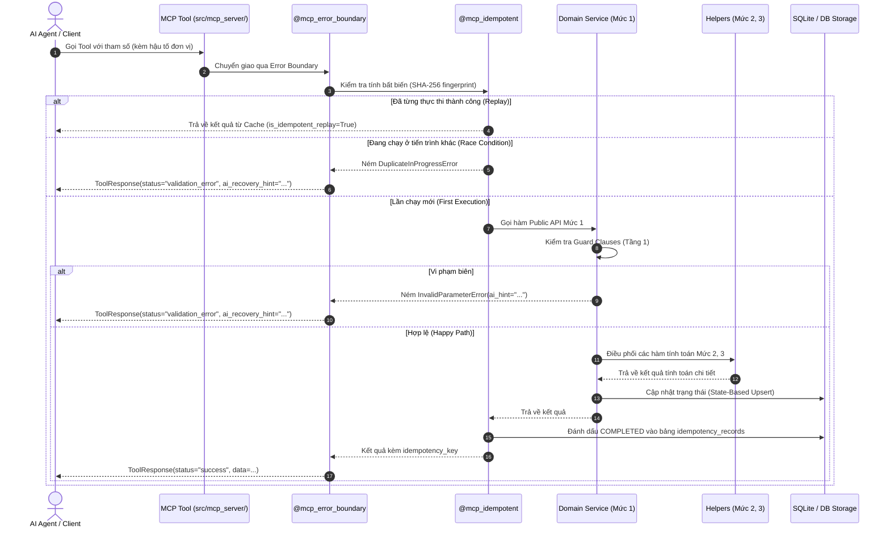

# Kiến Trúc Chi Tiết: Domain-Driven Design & MCP Tool Adapter

Tài liệu này cung cấp hướng dẫn kiến trúc chi tiết, mẫu thiết kế code và các kịch bản kiểm thử mẫu cho các lập trình viên và AI Agent khi làm việc trong hệ thống.

---

## 1. Sơ Đồ Tuần Tự (Sequence Diagram) Khi AI Gọi MCP Tool



---

## 2. Mã Nguồn Mẫu Hoàn Chỉnh

### A. Tầng Domain: `src/domain/structural.py`
```python
"""
Nghiệp vụ tính toán và đánh giá sức chịu tải phần tử kết cấu.
Tuân thủ Clean Code Mức 1 - 2 - 3, SLA và Stepdown Rule.
"""

from typing import Any, Protocol
from src.core.exceptions import InvalidParameterError, ResourceNotFoundError

# Bảng tra cứu mác thép (Lookup Table thay cho if-elif-else)
STEEL_YIELD_STRENGTH_MAP: dict[str, float] = {
    "S235": 235.0,
    "S275": 275.0,
    "S355": 355.0,
    "S450": 450.0,
}


class StructuralRepository(Protocol):
    """Protocol tiêm phụ thuộc (Dependency Injection) cho lưu trữ dữ liệu."""
    def save_evaluation(self, steel: str, w_cm3: float, force_kn: float, status: str) -> None:
        ...


# =====================================================================
# === MỨC 1: PUBLIC API (Điều phối nghiệp vụ mức cao - SLA)
# =====================================================================

def evaluate_and_record_beam_capacity(
    steel_grade: str,
    section_modulus_w_cm3: float,
    applied_force_f_kn: float,
    repository: StructuralRepository,
) -> dict[str, Any]:
    """
    Đánh giá khả năng chịu uốn của dầm thép và lưu trữ kết quả kiểm định.
    """
    # Tầng 1: Guard Clauses
    _validate_evaluation_inputs(steel_grade, section_modulus_w_cm3, applied_force_f_kn)

    # Tầng 2: Tính toán sức chịu tải qua các helper Mức 2
    fy_mpa = STEEL_YIELD_STRENGTH_MAP[steel_grade]
    capacity_kn = _calculate_design_capacity(section_modulus_w_cm3, fy_mpa)
    is_safe = applied_force_f_kn <= capacity_kn

    # Tầng 3: Lưu trữ và trả về kết quả
    status_label = "OK" if is_safe else "FAIL"
    _persist_evaluation_state(repository, steel_grade, section_modulus_w_cm3, applied_force_f_kn, status_label)

    return {
        "steel_grade": steel_grade,
        "design_capacity_kn": round(capacity_kn, 2),
        "applied_force_kn": round(applied_force_f_kn, 2),
        "is_safe": is_safe,
        "status": status_label,
    }


# =====================================================================
# === MỨC 2 & 3: PRIVATE HELPERS (_func)
# =====================================================================

def _validate_evaluation_inputs(steel_grade: str, w_cm3: float, force_kn: float) -> None:
    if w_cm3 <= 0:
        raise InvalidParameterError(
            message=f"Mô men kháng uốn W={w_cm3} cm3 không hợp lệ.",
            ai_hint="Mô men kháng uốn W phải là một số dương lớn hơn 0."
        )
    if force_kn < 0:
        raise InvalidParameterError(
            message=f"Tải trọng F={force_kn} kN không hợp lệ.",
            ai_hint="Tải trọng tác dụng F phải lớn hơn hoặc bằng 0."
        )
    if steel_grade not in STEEL_YIELD_STRENGTH_MAP:
        valid_steels = ", ".join(STEEL_YIELD_STRENGTH_MAP.keys())
        raise InvalidParameterError(
            message=f"Mác thép '{steel_grade}' không được hỗ trợ.",
            ai_hint=f"Vui lòng chỉ sử dụng một trong các mác thép sau: {valid_steels}."
        )


def _calculate_design_capacity(w_cm3: float, fy_mpa: float) -> float:
    # Công thức: Cap = W * fy / 1.05
    return (w_cm3 * fy_mpa) / 1.05


def _persist_evaluation_state(
    repo: StructuralRepository,
    steel: str,
    w: float,
    f: float,
    status: str,
) -> None:
    repo.save_evaluation(steel, w, f, status)
```

---

### B. Tầng Adapter MCP: `src/mcp_server/structural_tools.py`
```python
"""
MCP Server Tool Adapter cho mô-đun kết cấu thép.
Tuân thủ Quy chuẩn Mức 0: Đơn vị trong tên biến, Decorator theo thứ tự chuẩn.
"""

from typing import Annotated, Any
from pydantic import Field
from fastmcp import FastMCP
from src.core import mcp_error_boundary, mcp_idempotent, SQLiteIdempotencyStore
from src.domain.structural import evaluate_and_record_beam_capacity

mcp = FastMCP("StructuralEngineeringServer")
idempotency_store = SQLiteIdempotencyStore("data/idempotency.sqlite3")


@mcp.tool()
@mcp_error_boundary
@mcp_idempotent(store=idempotency_store, ttl_seconds=300.0)
def check_and_save_beam_capacity(
    steel_grade: Annotated[str, Field(description="Mác thép kết cấu, ví dụ: 'S235', 'S355'")],
    section_modulus_w_cm3: Annotated[float, Field(gt=0, description="Mô men kháng uốn W của tiết diện (cm3)")],
    applied_force_f_kn: Annotated[float, Field(ge=0, description="Lực tác dụng tính toán F (kN)")],
) -> dict[str, Any]:
    """
    [System Prompt cho AI Agent]
    - Mục đích: Đánh giá khả năng chịu uốn của dầm thép và lưu trữ kết quả vào hệ thống.
    - Khi nào gọi: Gọi khi cần thẩm tra một dầm chịu lực theo tiêu chuẩn kết cấu.
    - Ý nghĩa kết quả: Trả về kết quả 'is_safe' (True/False) kèm sức chịu tải giới hạn (kN).
    """
    # Tiêm repository thực tế
    from src.infrastructure.repositories import DefaultStructuralRepo
    repo = DefaultStructuralRepo()

    return evaluate_and_record_beam_capacity(
        steel_grade=steel_grade,
        section_modulus_w_cm3=section_modulus_w_cm3,
        applied_force_f_kn=applied_force_f_kn,
        repository=repo,
    )
```
