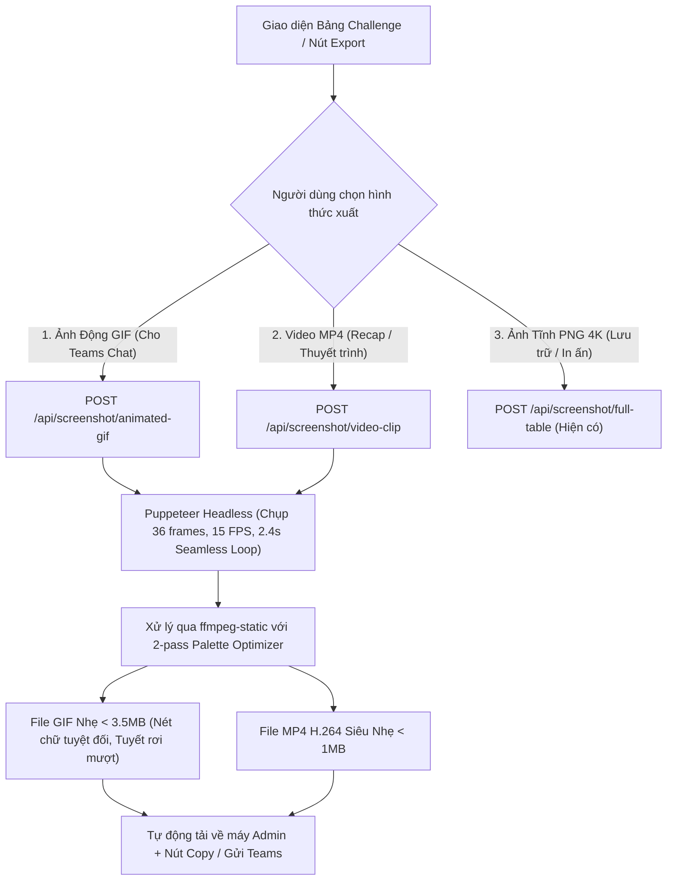

# KẾ HOẠCH & ĐỀ XUẤT KỸ THUẬT: XUẤT ẢNH ĐỘNG GIF / VIDEO CHO MICROSOFT TEAMS CHAT

## 1. Mục Tiêu & Yêu Cầu Cốt Lõi (Objective & Requirements)

Người dùng yêu cầu khả năng xuất bảng xếp hạng **Strava Challenge** (với chủ đề Giáng Sinh gồm tuyết rơi 3D, đèn nhấp nháy đa sắc, chuông đung đưa) thành **ảnh động GIF** hoặc **định dạng đa phương tiện phù hợp** để khi gửi vào kênh chat **Microsoft Teams**, các thành viên và đồng nghiệp trong công ty có thể nhìn thấy ngay hiệu ứng tuyết rơi và không khí lễ hội lung linh mà không bị biến thành ảnh tĩnh.

---

## 2. Phân Tích Tính Tương Thích Của Các Định Dạng Trên Microsoft Teams

Để đạt được hiệu ứng thị giác *"mở tin nhắn ra là thấy tuyết rơi ngay lập tức"*, định dạng file gửi vào Microsoft Teams đóng vai trò then chốt:

| Định dạng | Cơ chế hiển thị trên MS Teams | Đánh giá trải nghiệm thực tế (UX) | Tương thích Teams (Desktop / Web / Mobile) |
| :--- | :--- | :--- | :--- |
| **1. Animated GIF (`.gif`)** 🏆 | **Tự động phát (Autoplay)** & lặp vô tận (Loop) ngay trong dòng chat, không cần người nhận bấm nút gì. | **Tuyệt vời nhất (10/10)**: Mọi người trong channel/chat mở tin nhắn là thấy ngay bảng điểm lung linh tuyết rơi. | **100% Native** trên cả Teams Desktop (Windows/Mac), Teams Web và Teams Mobile (iOS/Android). |
| **2. Video MP4 (`.mp4` / H.264)** | Hiển thị dạng khung video có nút **Play ▶** ở giữa hoặc file đính kèm. | **Khá (7/10)**: Không tự động phát; người xem phải chủ động click nút Play. Bù lại độ phân giải cực nét, hỗ trợ 60fps và file siêu nhẹ (< 1MB). | **100% Native** trên mọi nền tảng. Phù hợp làm video recap / họp tổng kết. |
| **3. Animated WebP (`.webp`)** | Hỗ trợ hiển thị ảnh nhưng tính năng chạy animation phụ thuộc client Teams. | **Rủi ro (5/10)**: Teams Media Service khi nén qua cloud đôi khi chỉ lấy frame đầu tiên làm ảnh tĩnh trên một số phiên bản Teams Mobile. | Không đồng đều (hỗ trợ tốt trên Chromium Desktop, rủi ro trên Mobile). |
| **4. APNG (Animated PNG)** | Tương tự Animated WebP. | **Kém (4/10)**: Đa phần hiển thị thành ảnh tĩnh frame 1 trên MS Teams. | Kém tương thích trên Teams. |

> [!IMPORTANT]
> **Khẳng định cốt lõi**: **Animated GIF** là định dạng bắt buộc số 1 để đạt mục tiêu **tự động phát chuyển động tuyết rơi và đèn nhấp nháy ngay trong khung chat Teams**.

---

## 3. Các Phương Án Kỹ Thuật Triển Khai (Technical Options & Trade-offs)

### Phương Án A (Khuyến nghị số 1 - Recommended): Puppeteer Frame-Stepper + Bộ Ghép GIF / MP4 Tối Ưu Bằng `ffmpeg-static`
- **Nguyên lý hoạt động**:
  1. Backend Express mở một phiên headless Chrome qua `puppeteer-core`.
  2. Dùng kỹ thuật **Deterministic Frame Stepping**: Backend điều khiển thời gian bước nhảy (ví dụ: mỗi bước nhảy 66ms ứng với 15 FPS, tổng thời lượng 2.5s $\to$ 38 frames).
  3. Chụp từng frame trực tiếp vào RAM (Buffer).
  4. Sử dụng package `ffmpeg-static` (tự động đính kèm binary ffmpeg gọn nhẹ của nền tảng mà không cần cài thêm phần mềm ngoài máy tính) kết hợp bộ lọc 2 pha:
     - `palettegen`: Trích xuất bảng 256 màu tối ưu nhất, ưu tiên giữ độ nét cho chữ và số trên bảng điểm.
     - `paletteuse=diff_mode=rectangle`: Chỉ nén các vùng pixel chuyển động (tuyết rơi/đèn nháy), giữ tĩnh tuyệt đối vùng bảng điểm giúp dung lượng GIF giảm tới 65%.
- **Ưu điểm**:
  - Chất lượng chữ và số trên bảng xếp hạng nét căng như ảnh PNG, không bị mờ nhòe chữ.
  - Hiệu ứng tuyết rơi và đèn nhấp nháy mượt mà 100%, không bao giờ bị giật hay rớt khung hình kể cả khi máy admin đang bận tải nặng.
  - Chu kỳ lặp vô tận hoàn hảo (Seamless Loop): Frame cuối trùng khớp frame đầu.
  - Hỗ trợ xuất đồng thời cả 2 nút: **"Xuất GIF Động (cho Teams)"** và **"Xuất Video MP4 (Full HD)"**.
- **Nhược điểm**: Thời gian render mất khoảng 3 - 5 giây trên máy tính Admin.

---

### Phương Án B: Client-side Capture Trực Tiếp Bằng Browser Canvas + `gifshot` / `modern-gif`
- **Nguyên lý hoạt động**:
  1. Xử lý 100% bằng JavaScript chạy trên trình duyệt người dùng qua thư viện `modern-gif` hoặc WebAssembly encoder.
  2. Dùng `html-to-image` chụp canvas liên tục trong 2 giây rồi đóng gói thành GIF.
- **Ưu điểm**:
  - Không cần gọi backend, giảm tải cho server Express.
- **Nhược điểm**:
  - `html2canvas` / `html-to-image` khi chụp liên tục các thẻ có hiệu ứng kính mờ `backdrop-filter: blur()`, SVG gradient phức tạp và box-shadow thường bị sai lệch màu sắc hoặc mất hiệu ứng bóng.
  - Khi đang render GIF, trình duyệt của Admin sẽ bị đơ (lag) từ 5 - 10 giây.
  - Chất lượng nén bảng màu của encoder JS trên trình duyệt kém hơn hẳn so với thuật toán C/Rust, file GIF sinh ra thường rất nặng (> 8MB - 12MB).

---

### Phương Án C: Puppeteer Screen Recorder CDP (Quay Màn Hình Thời Gian Thực)
- **Nguyên lý hoạt động**:
  1. Puppeteer kích hoạt `Page.startScreencast` quay màn hình trong đúng 3 giây thực tế, xuất file `.webm` hoặc `.mp4`.
- **Ưu điểm**:
  - Rất nhanh cho video MP4.
- **Nhược điểm**:
  - Nếu CPU máy Admin đang bận (ví dụ đang đồng bộ Strava), tốc độ quay sẽ bị rớt frame, làm tuyết rơi bị khựng giật.
  - Khi chuyển từ video sang GIF, chữ trên bảng sẽ bị vỡ hạt (artifact) do bị nén 2 lần.

---

## 4. Kiến Trúc Giải Pháp Khuyến Nghị: Dual Mode GIF & MP4

Chúng tôi khuyến nghị chọn **Phương Án A** với kiến trúc **Dual Mode**:

### Bí quyết tối ưu dung lượng cho Microsoft Teams (< 4MB):
1. **Seamless Loop 2.4 giây ở 15 FPS**: Tổng cộng 36 frames. Chu kỳ đèn nháy và tuyết rơi được đồng bộ chu kỳ để frame 36 nối tiếp mượt mà vào frame 1.
2. **Kích thước ảnh động tối ưu**: Render ở bề ngang 1000px - 1200px (độ phân giải chuẩn vừa vặn khung xem tin nhắn của MS Teams mà không làm tràn màn hình chat).
3. **Palette Differential Compression**: Áp dụng bộ lọc `palettegen=stats_mode=diff` giúp vùng bảng điểm tĩnh không tốn dung lượng byte, chỉ tốn byte cho các hạt tuyết rơi và ánh sáng đèn.

---

## 5. Phạm Vi Tác Động (Blast Radius)

- `server/package.json` & `package.json`: Bổ sung dependency `ffmpeg-static` (tự động mang theo binary ffmpeg tương thích nền tảng, không cần cài đặt ngoài).
- `server/index.js`: Thêm 2 endpoints mới:
  - `POST /api/screenshot/animated-gif`
  - `POST /api/screenshot/video-clip`
- `frontend/src/components/ChallengeTable.jsx` & `frontend/src/utils/screenshot.js`:
  - Mở rộng menu Export Screenshot với 3 lựa chọn trực quan:
    1. 📸 **Ảnh tĩnh PNG 4K** *(Sắc nét in ấn)*
    2. 🎞️ **Ảnh động GIF** *(Tự động chạy tuyết rơi trên MS Teams)*
    3. 🎥 **Video Clip MP4** *(Full HD nhẹ mượt)*
- `frontend/src/i18n/translations.js`: Thêm nhãn song ngữ cho các tùy chọn xuất GIF và MP4.

---

## 6. Kế Hoạch Triển Khai Từng Bước (Step-by-Step Execution Plan)

1. **Bước 1: Cài đặt Module Xử Lý Đồ Họa Động**:
   - Cài đặt `ffmpeg-static` vào backend.
2. **Bước 2: Xây dựng Bộ Engine Chụp Frames & Đóng Gói GIF/MP4**:
   - Viết module `server/animated_recorder.js` sử dụng Puppeteer để chụp chuỗi frames theo bước thời gian và pipe trực tiếp vào FFmpeg palettegen/paletteuse.
3. **Bước 3: Tích hợp API Endpoint Vào Server**:
   - Endpoint `/api/screenshot/animated-gif` trả về buffer `image/gif`.
   - Endpoint `/api/screenshot/video-clip` trả về buffer `video/mp4`.
4. **Bước 4: Nâng cấp Giao Diện Menu Xuất Ảnh Trên Frontend**:
   - Bổ sung dropdown hoặc dialog chọn định dạng (PNG 4K / GIF Teams / MP4 Video) kèm thanh tiến trình render thân thiện.
5. **Bước 5: Kiểm Thử Thực Tế & Xuất Thử File GIF / MP4**:
   - Chạy script kiểm thử tạo file GIF và MP4 thực tế.
   - Đo lường dung lượng file, thời gian render và kiểm tra trực tiếp độ sắc nét của chữ và chuyển động tuyết rơi.

---

## 7. Dự Đoán Rủi Ro & Biện Pháp Kiểm Soát (Risks & Mitigations)

| Rủi ro tiềm ẩn | Biện pháp kiểm soát kỹ thuật |
| :--- | :--- |
| **Dung lượng GIF quá lớn gửi qua Teams bị chậm** | Giới hạn bề rộng 1000px - 1200px, 15 FPS, thời lượng 2.4s, áp dụng `paletteuse=diff_mode=rectangle` để ép file xuống dưới **3MB - 4MB**. |
| **Server bị treo nếu chụp quá nhiều frame** | Dùng cơ chế Stream/Pipe trực tiếp vào ffmpeg, không lưu hàng trăm file ảnh tạm lên đĩa cứng tránh tràn RAM/I/O. Bổ sung timeout 30s. |
| **Chữ số trong bảng bị mờ khi giảm màu GIF (256 màu)** | Thuật toán `palettegen` lấy mẫu màu cục bộ cho vùng text giúp chữ giữ nguyên màu Navy/Teal sắc nét, chỉ phối màu dithering cho các hạt tuyết mờ. |

