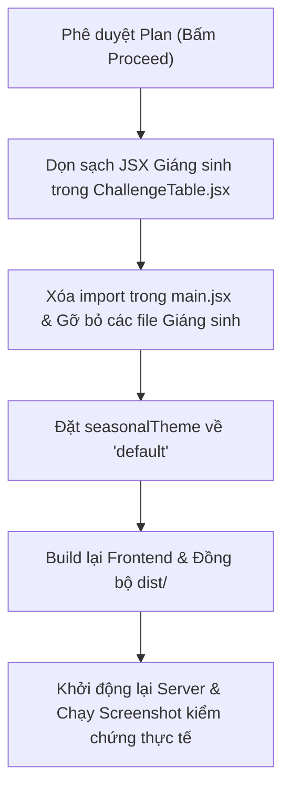

# Kế Hoạch Gỡ Bỏ Hoàn Toàn Theme Giáng Sinh (Christmas Theme Removal Plan)

> **Mục tiêu:** Gỡ bỏ toàn bộ các thành phần trang trí, hiệu ứng tuyết rơi, dải cành thông, cây thông, người tuyết, mũ Noel và các file CSS liên quan đến Giáng sinh khỏi bảng xếp hạng **Monthly Challenge Leaderboard**, khôi phục giao diện trở về trạng thái chuẩn doanh nghiệp mặc định (Clean Default UI) của Haskoning.

---

## 1. Phân Tích & Phạm Vi Ảnh Hưởng (Blast Radius)

### 1.1. Các phần tử Giáng sinh cần loại bỏ:
1. **Lớp phủ kính & Hiệu ứng động:**
   - `<ChristmasGlassOverlay />`: Gồm tuyết rơi 3D parallax, dải thông mép trên/dưới, chùm chuông vàng, nơ đỏ, cây thông 260px, người tuyết 240px, viền sương giá.
2. **Nóc bảng & Tiêu đề:**
   - `<ChristmasSantaHatOnTitle />`: Chiếc mũ Noel trên chữ cái đầu của tiêu đề.
   - `<ChristmasDropdownSnow />`: Mái tuyết phủ trên dropdown tháng.
   - `<ChristmasLeaderPillSnow />`: Mái tuyết phủ trên pill Quán quân.
   - Biểu tượng cây thông 🎄 cạnh tiêu đề bảng.
3. **Màu sắc & Lớp tuyết vi mô:**
   - Dải màu gradient xanh thông trên cột ngày 1..30 (khôi phục hàm `getDayHeaderStarColor` nguyên bản).
   - Class `snow-capped-element` đọng tuyết trên các badge *YOU*, ô input target, pill tiền phạt, thanh tiến độ.
   - Class `.challenge-table--christmas` trên container bảng.
4. **Mã nguồn & File tài nguyên liên quan:**
   - [frontend/src/components/ChristmasDecorations.jsx](file:///c:/Users/926166/OneDrive%20-%20Haskoning/Tien_926166/Strava_Desktop_Software/frontend/src/components/ChristmasDecorations.jsx)
   - [frontend/src/components/ChristmasGlassOverlay.jsx](file:///c:/Users/926166/OneDrive%20-%20Haskoning/Tien_926166/Strava_Desktop_Software/frontend/src/components/ChristmasGlassOverlay.jsx)
   - [frontend/src/styles/christmasTableTheme.css](file:///c:/Users/926166/OneDrive%20-%20Haskoning/Tien_926166/Strava_Desktop_Software/frontend/src/styles/christmasTableTheme.css)
   - Dòng import trong [frontend/src/main.jsx](file:///c:/Users/926166/OneDrive%20-%20Haskoning/Tien_926166/Strava_Desktop_Software/frontend/src/main.jsx).

---

## 2. Đề Xuất & Khuyến Nghị (Recommendations & Trade-offs)

| Tiêu chí | Phương án A (Khuyến nghị) - Gỡ bỏ triệt để (Clean Purge) | Phương án B - Chỉ tắt cờ hiển thị (Soft Disable) |
| :--- | :--- | :--- |
| **Cách xử lý** | Gỡ sạch các JSX, import và xóa các file Giáng sinh khỏi repo; đặt theme mặc định. | Giữ nguyên các file code, chỉ đặt trạng thái `seasonalTheme = 'default'` để ẩn đi. |
| **Độ sạch của Codebase** | Sạch 100%, không còn dead code, bundle JS/CSS nhỏ hơn ~50KB, loại bỏ hoàn toàn mã thừa. | Vẫn còn ~50KB CSS/JS Giáng sinh trong bundle tải về trình duyệt. |
| **Rủi ro ảnh hưởng** | Không có rủi ro nếu dọn dẹp cẩn thận; khôi phục đúng mã nguồn trước khi gắn theme. | Dễ phát sinh xung đột CSS ngầm nếu các selector CSS cũ vẫn được nạp. |

> **Khuyến nghị:** Chọn **Phương án A (Gỡ bỏ triệt để)** để mã nguồn bảng Challenge trở về trạng thái sạch sẽ, chuyên nghiệp, chạy nhanh nhẹn và chuẩn xác nhất theo đúng văn hóa kỹ thuật cao cấp.

---

## 3. Kế Hoạch Thực Hiện Từng Bước (Step-by-step Execution Plan)

### Bước 1: Dọn dẹp [frontend/src/components/ChallengeTable.jsx](file:///c:/Users/926166/OneDrive%20-%20Haskoning/Tien_926166/Strava_Desktop_Software/frontend/src/components/ChallengeTable.jsx)
- Xóa các dòng import: `ChristmasGlassOverlay`, `ChristmasDropdownSnow`, `ChristmasLeaderPillSnow`, `ChristmasSantaHatOnTitle`.
- Xóa class `${isChristmas ? 'challenge-table--christmas' : ''}`.
- Xóa các phần tử JSX:
  - `{isChristmas && <ChristmasSantaHatOnTitle />}`
  - `{isChristmas && 🎄}`
  - `{isChristmas && <ChristmasDropdownSnow />}`
  - `{isChristmas && <ChristmasLeaderPillSnow />}`
  - `{isChristmas && <ChristmasGlassOverlay />}`
- Khôi phục màu nền cột ngày: Trở về gọi trực tiếp `style={{ background: getDayHeaderStarColor(day, daysArray.length) }}`.
- Xóa các class `snow-capped-element` trên badge, input, pill phạt, progress bar.

### Bước 2: Dọn dẹp [frontend/src/main.jsx](file:///c:/Users/926166/OneDrive%20-%20Haskoning/Tien_926166/Strava_Desktop_Software/frontend/src/main.jsx)
- Xóa dòng: `import './styles/christmasTableTheme.css'`

### Bước 3: Xóa các file tài nguyên Giáng sinh
- Xóa `frontend/src/components/ChristmasDecorations.jsx`
- Xóa `frontend/src/components/ChristmasGlassOverlay.jsx`
- Xóa `frontend/src/styles/christmasTableTheme.css`

### Bước 4: Đóng gói Frontend & Đồng bộ `dist/`
- Chạy lệnh `npm run build --prefix frontend`.
- Đồng bộ toàn bộ `frontend/dist` sang `dist/`.

### Bước 5: Kiểm chứng Thực tế
- Khởi động lại Server daemon.
- Chạy script kiểm thử chụp ảnh Option 3 để xác nhận bảng Challenge đã trở về trạng thái gốc mặc định sạch bóng, không còn bất kỳ chi tiết Giáng sinh nào.
- Dùng `view_file` mở trực tiếp ảnh chụp để đối chiếu và báo cáo trung thực.

---

## 4. Tiêu Chí Hoàn Thành (Definition of Done)
1. Bảng Challenge trở về 100% giao diện mặc định ban đầu của Haskoning.
2. Không còn bất kỳ file Giáng sinh hay lỗi compile nào trong frontend.
3. Bản build Vite thành công với 0 lỗi.
4. Ảnh chụp màn hình kiểm chứng xác nhận giao diện sạch hoàn toàn.
